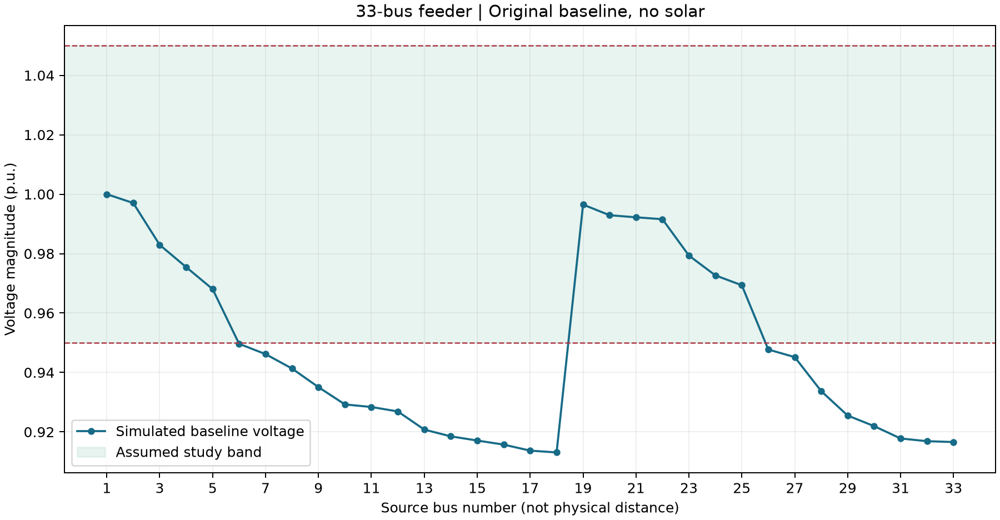

# Baseline engineering report

Status: simulated baseline milestone, not a completed hosting-capacity study.

## Model and assumptions

Unmodified Baran-Wu 33-bus case from pandapower 3.3.2.
Balanced steady-state AC power flow, constant PQ demand, original radial topology,
original source voltage, no solar and no controller. The 0.95–1.05 p.u.
voltage band is an assessment assumption, not a claimed regulatory requirement.

## Simulated results

| Metric | Value |
|---|---:|
| Total demand | 3.7150 MW |
| Reactive demand | 2.3000 MVAr |
| Source real power | 3.917677 MW |
| Line losses | 202.677 kW |
| Minimum voltage | 0.913090 p.u. |
| Minimum-voltage source bus | 18 |
| Buses below study band | 21 |
| Buses above study band | 0 |
| Baseline within study band | False |

## Numerical verification

- Power-balance residual: -6.090e-14 MW.
- Maximum Newton-Raphson / backward-forward sweep voltage difference: 1.019e-10 p.u.
- Independent two-bus voltage-drop approximation relative error: 0.034%.
- Two-bus calculated 3 I^2 R loss: 0.000028969 MW.
- Two-bus simulated loss: 0.000028969 MW.
- Numerical checks passed: True.

Solver agreement is a cross-check within one library, not independent software validation.
The voltage-drop approximation is used only for a lightly loaded two-bus case.

## Interpretation and next step

Numerical correctness and voltage acceptability are different checks. If the baseline
is outside the assumed band, that is a pre-existing issue, not an effect of solar.
Do not infer a solar hosting capacity from this baseline. Next, define a separate,
explicit study configuration and test its no-solar feasibility before solar sweeps.
No limits, loads, or source settings have been silently changed to obtain compliance.

Thermal compliance, protection, unbalance, harmonics, and dynamic behavior are not
assessed. Line currents are exported, but thermal loading percentages are omitted.
This is a synthetic benchmark, not a model of a named utility feeder.

## Provenance

- https://pandapower.readthedocs.io/en/v3.3.2/networks/power_system_test_cases.html
- https://matpower.org/docs/ref/matpower6.0/case33bw.html
- Baran and Wu (1989), DOI: 10.1109/61.25627.

See summary.json for configuration, versions, timestamp, and numerical checks.
