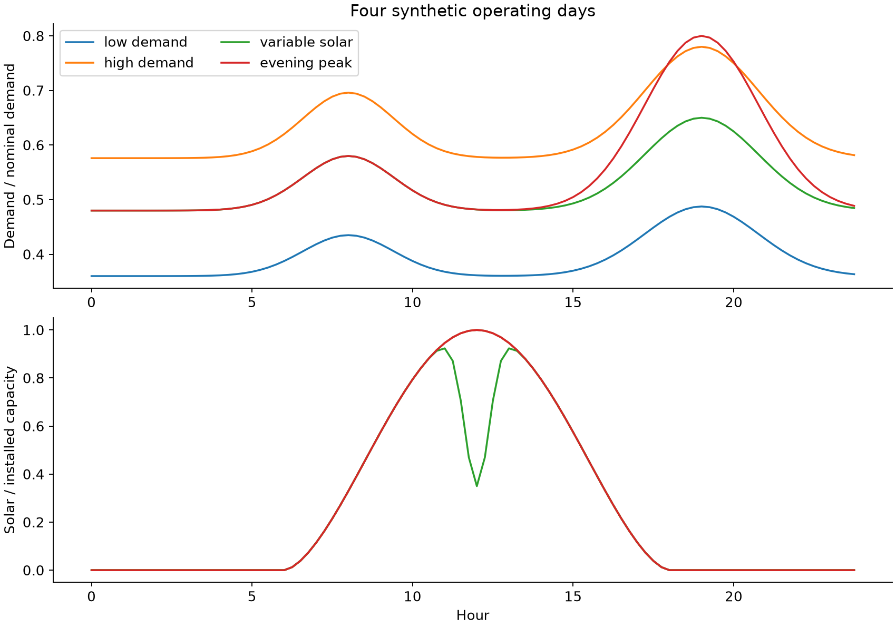
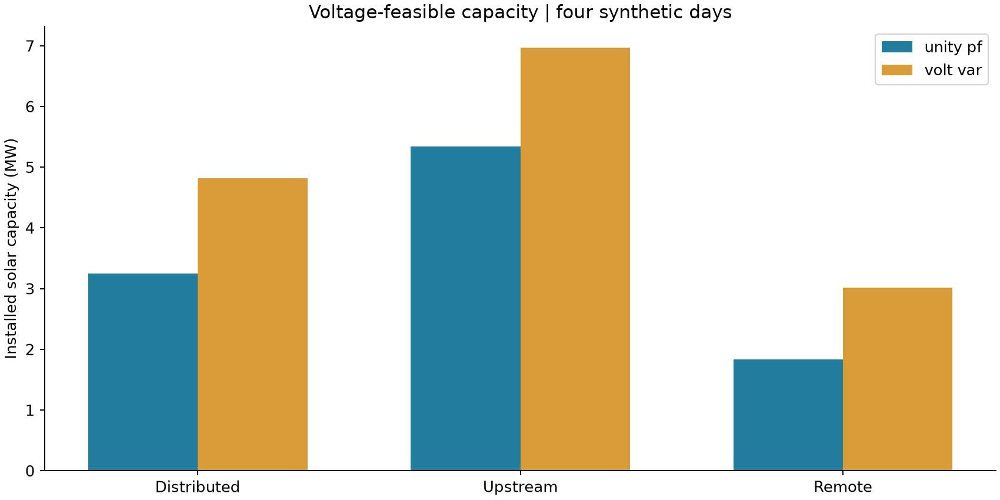
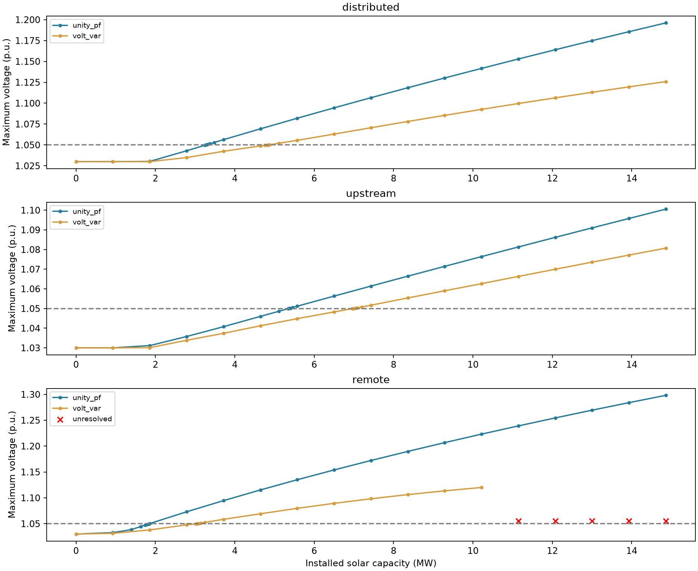
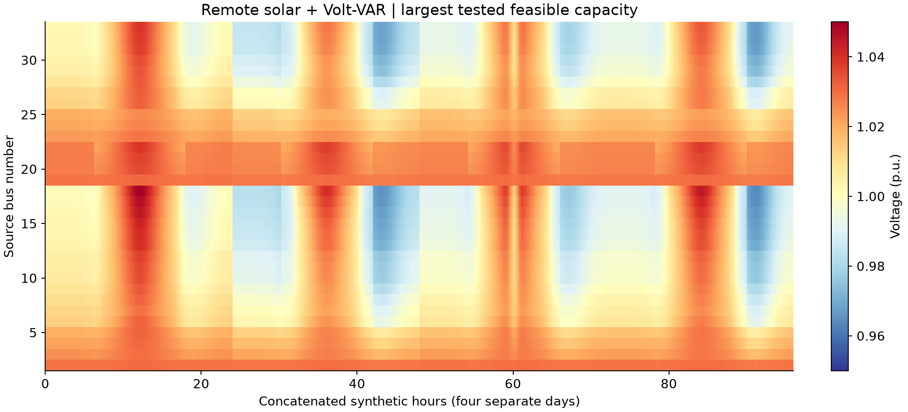
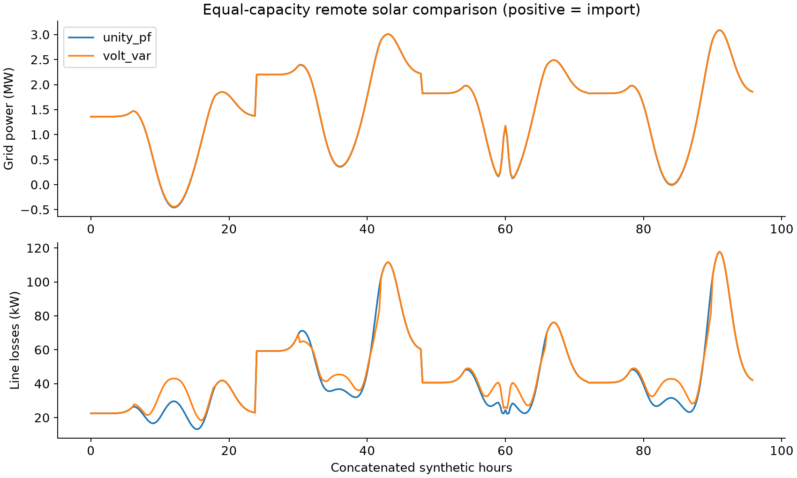
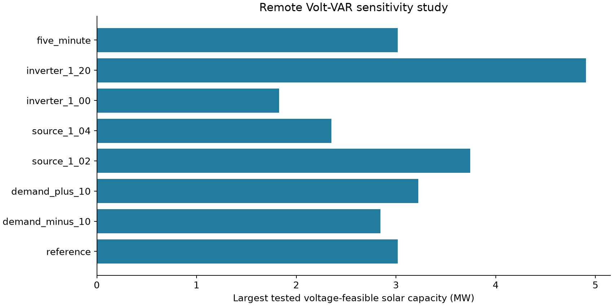

# Engineering report: solar hosting capacity of a 33-bus feeder

## Executive finding

Under the documented four-day synthetic study, inverter Volt-VAR control increased
the largest tested voltage-feasible solar capacity for all three placement patterns.
For remote solar the feasible endpoint increased from **1.828 MW to 3.018 MW**.
These are sampled voltage-feasibility boundaries, not utility-approved connection capacities.
High-capacity controller failures remain unresolved; a global maximum is not proven.

## 1. Benchmark, assumptions, and scope

The original Baran-Wu benchmark was reproduced without changes: 33 buses, 32 active
series branches, 12.66 kV, 3.715 MW and 2.300 MVAr nominal demand. Its minimum
voltage was 0.913090 p.u. at source bus 18, with 202.677 kW line losses. It does
not satisfy the project's assumed 0.95–1.05 p.u. band before any solar is added.

The separate solar study fixes the source voltage at **1.03 p.u.** and applies
documented demand multipliers. This is an assumed operating scenario, not a proposed
physical retrofit to the original system. All main and sensitivity scenarios passed
their no-solar baseline feasibility check. The unmodified benchmark remains separate.

The model is balanced, steady-state, constant-PQ, radial, with series line impedance
and no line shunts. There is no tap controller, storage, curtailment, or network
reconfiguration. Reverse power flow is reported but not prohibited. Thermal limits,
protection, harmonics, unbalance, dynamic stability, costs, and annual reliability
are not assessed. No thermal-loading percentages are claimed.

## 2. Synthetic inputs and solar placement

Four independent 24-hour scenarios are evaluated every 15 minutes (384 operating
points per capacity). They are deterministic experiments, not measured days.
With hour t, define:

- Solar: `max(0, sin(pi*(t-6)/12))**1.6`.
- Morning component: `exp(-((t-8)/2)**2)`.
- Evening component: `exp(-((t-19)/2.5)**2)`.
- Reference demand multiplier: `0.48 + 0.10*morning + 0.17*evening`.
- Low demand: reference multiplied by 0.75; high demand: multiplied by 1.20.
- Variable solar: reference demand, solar multiplied by
  `1 - 0.65*exp(-((t-12)/0.55)**2)`.
- Evening peak: `0.48 + 0.10*morning + 0.32*evening`.

Both P and Q demand scale together. Solar output is the profile times installed
AC real-power capacity. Inverter apparent rating is 1.10 times that capacity.
There is no random seed because there is no randomness. The five-minute comparison
resamples the same analytical profiles and adds no measured information.

Distributed solar is allocated in proportion to nominal bus real-power demand.
Upstream solar is split equally between source buses 3, 4 and 5. Remote solar is
split equally between source buses 18, 22 and 33. Equal total capacity is used
when comparing allocations and the paired control comparison.

## 3. Numerical methods

Pandapower supplies the benchmark and Newton-Raphson reference solutions. For the
large sweep, an independently implemented, vectorized radial fixed-point AC solver
uses `V = Vsource - Zbus * conjugate(S/V)` on a 1 MVA, 12.66 kV base. Here S is
net complex consumption, including solar and inverter reactive injection with
the appropriate sign. Zbus is constructed from radial branch paths and impedances.
Branch currents, complex losses, and source power follow from the solved voltages.
The solver is restricted to the series-only balanced radial model; it is not a
general replacement for pandapower. Voltage-iteration tolerance is 1e-10 p.u.

Volt-VAR control injects Q below 0.99 p.u. and absorbs Q above 1.01 p.u., with
linear segments reaching the instantaneous capability limit at 0.95/1.05 p.u.
The cap is `sqrt(Srated**2 - P**2)`, with active-power priority. No nighttime Q
support is allowed. Each control update uses 25% of the target and retains 75%
of the previous value. Convergence requires Q error below 1e-6 MVAr and voltage
change below 1e-7 p.u.; the iteration ceiling is 160. This is numerical fixed-point
convergence, not a demonstration of inverter dynamic stability or grid-code compliance.

The capacity ratio H is total installed MW divided by fixed nominal load 3.715 MW.
The grid spans H=0 to 4 in steps of 0.25. Every observed converged pass/fail transition
is refined until its width is below 0.01 H (0.03715 MW). The actual reported intervals
are approximately 0.0290 MW wide. Feasibility requires every bus and time point
to remain in the study band. All coarse points and refinement points are retained;
this does not rule out narrow feasible islands between sampled points.

## 4. Capacity findings

| Placement | Control | Feasible lower endpoint (MW) | Infeasible upper endpoint (MW) | Unresolved sweep points |
| --- | --- | --- | --- | --- |
| distributed | unity_pf | 3.25062 | 3.27965 | 0 |
| distributed | volt_var | 4.81789 | 4.84691 | 0 |
| upstream | unity_pf | 5.34031 | 5.36934 | 0 |
| upstream | volt_var | 6.96562 | 6.99465 | 0 |
| remote | unity_pf | 1.82848 | 1.8575 | 0 |
| remote | volt_var | 3.01844 | 3.04746 | 5 |

The endpoints bracket observed local voltage boundaries. For remote Volt-VAR,
five higher-capacity coarse points failed control convergence. They are explicitly
unresolved, not physical voltage violations. They do not change the converged local
boundary bracket near 3.02 MW, but prevent an unqualified global-maximum claim.
The same distinction applies to unresolved sensitivity points.

## 5. Loss and current tradeoff at equal capacity

Both remote cases below use **1.828477 MW installed solar**, rather than comparing
different boundary capacities.

| control | max_voltage_pu | four_day_loss_kwh | peak_current_a | peak_export_mw |
| --- | --- | --- | --- | --- |
| unity_pf | 1.04963 | 4254.54 | 161.029 | 0.456104 |
| volt_var | 1.03762 | 4493.6 | 161.029 | 0.442727 |

Control reduced peak voltage from 1.049628 to 1.037625 p.u. Four-day line-loss energy
increased from 4254.543 to 4493.598 kWh, approximately 5.62%. Peak current over these
profiles was unchanged because a different operating interval sets that peak.
These four-day totals are not annual estimates, and lower voltage does not imply
lower losses. The exported paired time series supports inspection of these effects.

## 6. Sensitivity findings

| case | capacity_mw | baseline_feasible | unresolved_points |
| --- | --- | --- | --- |
| reference | 3.01844 | True | 5 |
| demand_minus_10 | 2.8443 | True | 5 |
| demand_plus_10 | 3.2216 | True | 5 |
| source_1_02 | 3.74402 | True | 5 |
| source_1_04 | 2.3509 | True | 5 |
| inverter_1_00 | 1.82848 | True | 4 |
| inverter_1_20 | 4.90496 | True | 6 |
| five_minute | 3.01844 | True | 5 |

Demand and source setpoint materially alter the result. Increasing source voltage
uses overvoltage headroom; larger inverter apparent rating increases reactive
capability at peak real-power output. With a 1.00 S/P ratio, Q capability is zero
at peak output, explaining why that case matches the unity-power-factor boundary.
Five-minute sampling retained the same sampled boundary in this particular profile
set; it does not prove that real fast solar fluctuations are unimportant.

## 7. Validation evidence

- Original-case Newton-Raphson and backward/forward sweep agree to about 1e-10 p.u.
- A separate lightly loaded two-bus voltage-drop approximation differs by about
  0.034%; independent `3 I^2 R` losses agree with the AC solution.
- The new radial solver was cross-checked against pandapower at **54**
  operating points, including selected extrema, across all six main cases.
- Maximum voltage difference: **3.014e-11 p.u.**
- Maximum line-loss difference: **1.269e-11 MW**.
- Maximum source-power difference: **1.440e-09 MW**.
- Nine automated tests cover benchmark values, topology, power balance, solver
  agreement, a no-load limit, Q signs, capability clipping, night behavior,
  profile allocation, and controller fixed-point consistency.

Matching implementations validates the numerical model, not its representation of
a real utility. Published benchmark data, declared assumptions, and simulated
findings are separate evidence categories. See baseline/report.md, test source,
independent_solver_checks.csv and run_metadata.json for details.

## 8. Engineering recommendation and limitations

Use the results to explain how placement and reactive control affect voltage
headroom, and why the initial operating state matters. Before practical connection
decisions, obtain equipment ratings, measured time series, source regulation and
protection constraints, then validate an appropriate unbalanced feeder model.
Revisit unresolved high-capacity control points with robust control solvers before
making global optimization claims. Storage and curtailment are optional follow-on
projects, not missing requirements of this voltage-only core release.

## 9. Reproducibility and provenance

Commands and environment are documented in the repository README. The input
formulas are in study.py and exported to synthetic_profiles.csv. All evaluations,
including failures, are retained. The code hash, versions, and timestamp are in
run_metadata.json; release-manifest.json records delivered file hashes.

- Baran and Wu (1989), DOI: 10.1109/61.25627.
- https://matpower.org/docs/ref/matpower6.0/case33bw.html
- https://pandapower.readthedocs.io/en/v3.3.2/networks/power_system_test_cases.html
- https://pandapower.readthedocs.io/en/latest/powerflow/ac.html

This release was run locally. GitHub publication and hosted CI execution are not claimed.
